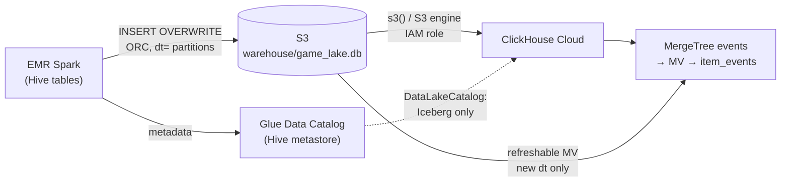
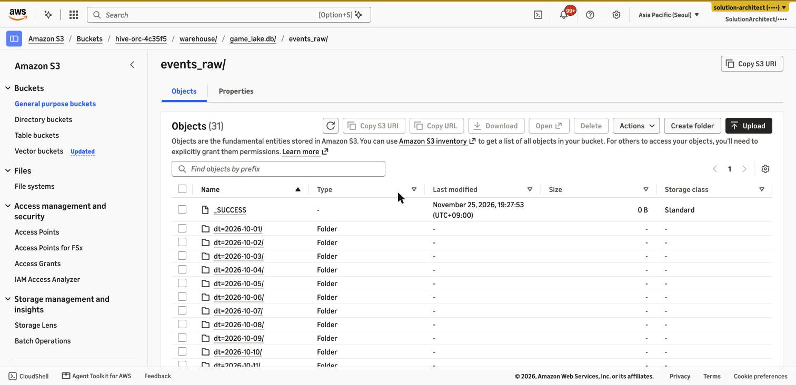
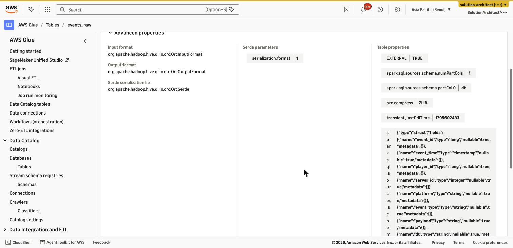
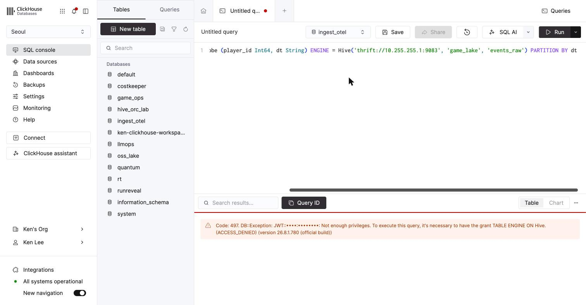
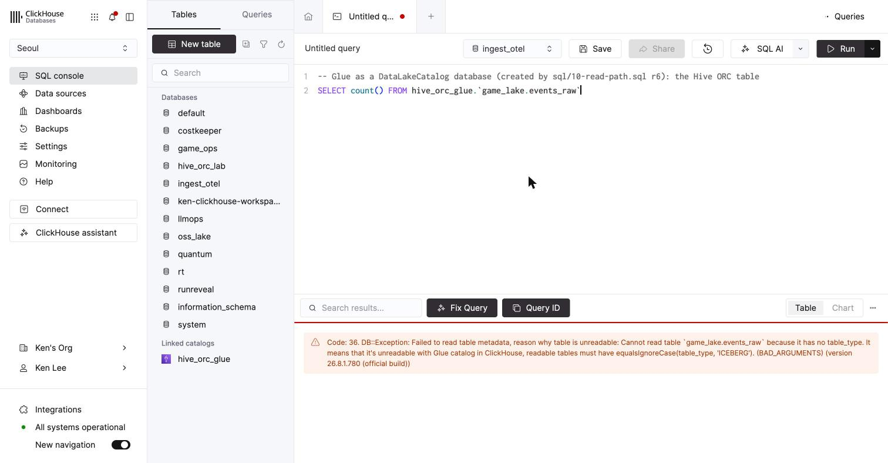
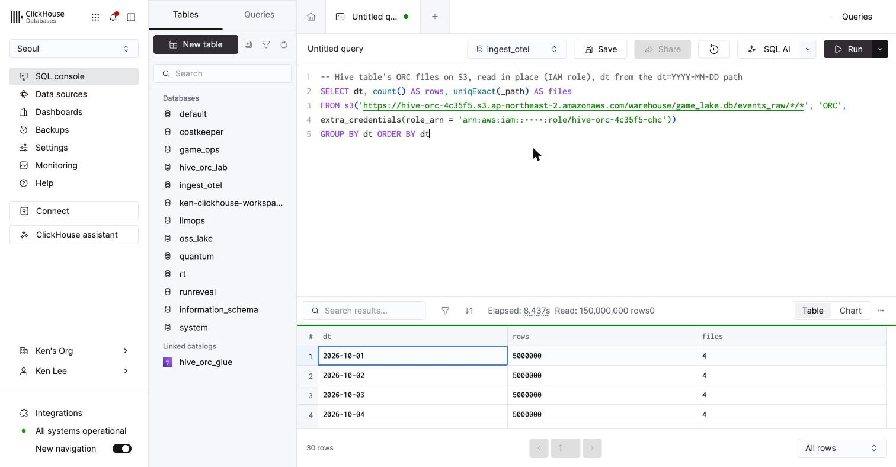
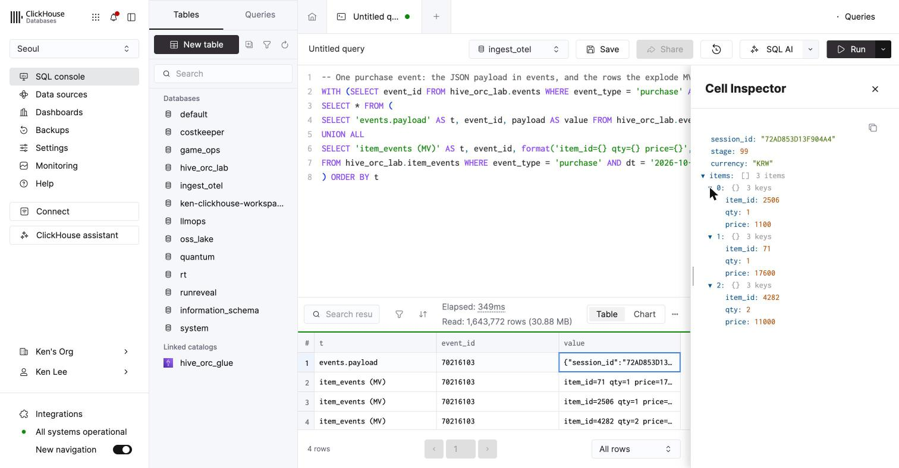
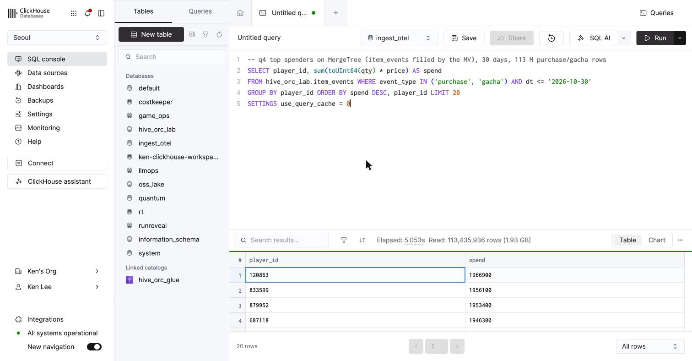
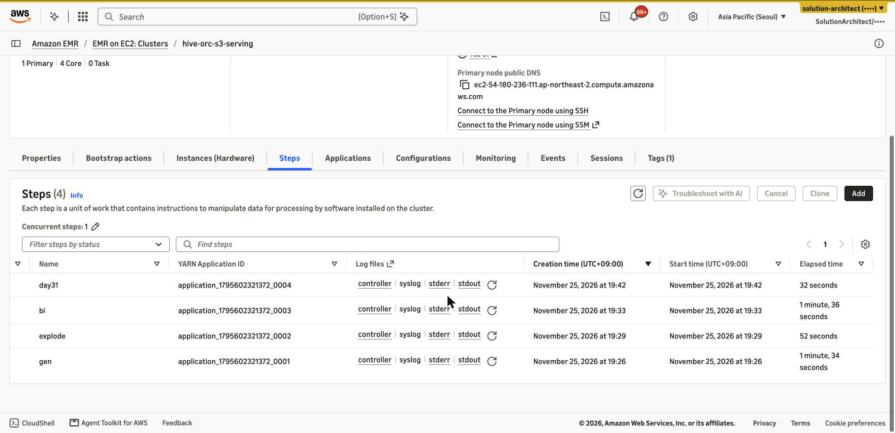

# Hive-catalog ORC tables on S3, served by ClickHouse Cloud — and the same work on EMR

> **Last run: 2026-11-25** — AWS `ap-northeast-2`: S3, Glue Data Catalog as the Hive metastore, EMR emr-7.14.0 (Spark 3.5.8, Hive 3.1.3; 1 × m7g.xlarge + 4 × m7g.2xlarge), Athena for one Iceberg copy; ClickHouse Cloud 26.8.1.780 (an existing service, 2 replicas × 8 GiB / 2 vCPU). `01-infra.sh` → `99-destroy.sh` ran end to end; the ClickHouse SQL ran through `ch_run.py` and in the SQL console. Two fixes made during the run are in the files (`ifNull(payload, '')` in `sql/30-transform.sql`, the Glue `default` database in `99-destroy.sh`). Details: [`results/RUN-2026-11-25.md`](results/RUN-2026-11-25.md).
>
> **마지막 실행: 2026-11-25** — AWS `ap-northeast-2`: S3, Hive 메타스토어로 쓴 Glue Data Catalog, EMR emr-7.14.0(Spark 3.5.8, Hive 3.1.3, m7g.xlarge 1대 + m7g.2xlarge 4대), Iceberg 사본 하나를 만든 Athena. ClickHouse Cloud 26.8.1.780(기존 서비스, 레플리카 2개 × 8 GiB / 2 vCPU). `01-infra.sh` → `99-destroy.sh`를 끝까지 실행했다. ClickHouse SQL은 `ch_run.py`와 SQL 콘솔로 실행했다. 실행 중 고친 두 가지(`sql/30-transform.sql`의 `ifNull(payload, '')`, `99-destroy.sh`의 Glue `default` 데이터베이스 정리)는 파일에 반영돼 있다. 자세한 기록: [`results/RUN-2026-11-25.md`](results/RUN-2026-11-25.md).

[English](#english) | [한국어](#한국어)

## English

> **Related notes**: [Serving Hive ORC Tables on S3 with ClickHouse Cloud: Measured Side by Side with EMR](https://clickhouse.litkhai.dev/en/articles/cloud/hive-orc-s3-serving-vs-emr/)

A game company runs Hadoop in its own data center: Hive tables stored as ORC, partitioned by day, with a Hive catalog. It is moving to AWS and weighs a hybrid: keep the tables in S3 under a Hive-compatible catalog, and put ClickHouse Cloud in front as the serving layer, against running the same work on EMR. This lab builds that estate with generated game logs and measures both sides.

### Answer

- **ClickHouse Cloud reads the Hive ORC files where they are.** `s3()` or an `S3` table over `…/events_raw/*/*` with `extra_credentials(role_arn = …)` reads Spark-written ORC (ZLIB). The `dt=YYYY-MM-DD` directories become a `dt` column (`Date`), and a filter on it opens only that day's files: 4 of 120 files, 0.68 s for one day.
- **It does not read them through the Hive catalog.** The `Hive` table engine and `hdfs()` are refused on Cloud (`… necessary to have the grant TABLE ENGINE ON Hive`, `… READ ON HDFS`), for the `default` user too. `DataLakeCatalog` over Glue lists Iceberg tables only. Selecting the Hive table fails with `readable tables must have equalsIgnoreCase(table_type, 'ICEBERG')`. The catalog keeps serving Spark, Hive and Athena. ClickHouse reads the table's S3 location.
- **The explode job becomes a materialized view.** One `INSERT … SELECT FROM s3()` loaded 30 days (150 M events) into MergeTree in 370.6 s. The MV wrote the 168.7 M exploded item rows in the same insert. A refreshable MV appended the next day's partition in 12.7 s. Row counts, sums and the five BI results matched Spark exactly.
- **Speed: EMR's 36 vCPU beat one 2-vCPU ClickHouse replica on the batch jobs.** The 30-day explode took 32 s of Spark SQL (52 s step) against 190 s in ClickHouse. The BI queries took 0.1–5 s on MergeTree and 0.9–3 s on Spark. Both sides used default settings, and ClickHouse used about one core for the insert.
- **Cost: the batch jobs cost cents on both sides. The difference is in keeping a serving layer up.** The explode cost $0.033 on EMR and $0.051 on ClickHouse. The whole run cost $0.96 for the EMR cluster's 25 minutes and $0.19 for the 66 ClickHouse statements. Kept up around the clock, the EMR cluster lists at $2.27/h ($1,658 per 730 h). The ClickHouse service lists at $0.96/h ($701), and it answers queries from MergeTree without a cluster start (EMR: 351 s, $0.22 per launch).

### Architecture



### Steps

```bash
cp env.example .env          # ClickHouse host/user/password, the service's IAM role, OpenAPI key
./01-infra.sh                # Terraform: bucket, Glue database game_lake, role for ClickHouse, EMR roles
./02-emr.sh                  # EMR cluster, Glue as the Hive metastore (~6 min to ready)
./03-emr-steps.sh gen        # 30 days x 5,000,000 events -> game_lake.events_raw (Hive, ORC, dt=)
./ch_run.py sql/10-read-path.sql       # s3(), S3 engine, Hive engine, hdfs(), Glue DataLakeCatalog
./03-emr-steps.sh explode    # Spark: explode items -> game_lake.item_events
./03-emr-steps.sh bi         # Spark SQL: the five BI queries, 3 runs, CSV results to S3
./ch_run.py sql/20-serving.sql         # MergeTree + explode MV, 30-day load from s3()
./ch_run.py sql/30-transform.sql       # the explode job as one INSERT ... SELECT FROM s3()
./ch_run.py sql/40-bi-queries.sql --runs 3
./ch_run.py sql/50-incremental.sql --only i1_rmv
./03-emr-steps.sh day31      # one more day on S3
./ch_run.py sql/50-incremental.sql --only i2_refresh,i3_wait,i4_status,i5_days
./ch_run.py sql/90-query-stats.sql     # durations, rows, files from system.query_log
./05-cost.py 2026-11-25      # Price List x EMR times, Usage Cost API for the day
./99-destroy.sh              # EMR, ClickHouse objects, Glue tables, Terraform stack
```

The Glue Iceberg check in `sql/10-read-path.sql` (`r8_*`) needs the Athena CTAS in the run log first.

### Results

| Work | EMR (36 vCPU) | ClickHouse Cloud (one 2-vCPU replica) |
|---|---|---|
| Explode 30 days, ORC → table | 32.4 s query / 52 s step · $0.033 | 189.7 s · $0.051 |
| Load 30 days into the serving layer + explode | — | 370.6 s · $0.099 |
| One new day | 12.7 s write / 32 s step · $0.020 | 12.7 s (refreshable MV) · $0.0034 |
| BI q1–q5, third run | 1.84 · 1.85 · 0.85 · 2.74 · 1.30 s | MergeTree 5.48 · 2.56 · 0.11 · 5.07 · 0.11 s; ORC 5.45 · 3.52 · 0.30 · 6.08 · 0.99 s |
| Start | 351 s · $0.22 per launch | none |
| Whole run | 25.3 min · $0.96 | 729 s of statements · $0.19 |
| Rate | $2.27/h (EC2 $1.81, EMR $0.37, EBS $0.10) | $0.96/h for the service (Usage Cost API) |

Stored size: 30 days of raw events take 4.80 GiB as ORC ZLIB and 4.09 GiB in MergeTree. The exploded items take 1.03 GiB as ORC and 1.75 GiB in MergeTree. All runs, conditions and the price derivation are in the run log.

### Screens

| | |
|---|---|
|  |  |
|  |  |
|  |  |
|  |  |

All 31 captures, with the step log and exact messages, are in [`results/RUN-2026-11-25.md`](results/RUN-2026-11-25.md).

### Notes

- The lab uses an existing ClickHouse Cloud service and drops only its own databases (`hive_orc_lab`, `hive_orc_glue`). The service autoscaled from 8 to 12 GiB per replica after the load (10:45 UTC). Use a service with fixed size to keep the cost of a run to the statements.
- Glue is the catalog because EMR, Athena and Spark all use it as a Hive metastore, and it has no server to keep running. An HMS on EMR would answer the same thrift calls, but ClickHouse Cloud's `Hive` engine is refused before any connection is made.
- Not tried: Spot or Graviton sizing on EMR, EMR Serverless, a larger or tuned ClickHouse service (`max_insert_threads`), more than 150 M rows.

## 한국어

> **관련 노트**: [S3의 Hive ORC 테이블을 ClickHouse Cloud로 서빙하기: 같은 작업을 EMR과 나란히 재 보기](https://clickhouse.litkhai.dev/articles/cloud/hive-orc-s3-serving-vs-emr/)

한 게임사가 자체 데이터센터에서 Hadoop을 운영한다. Hive 테이블은 ORC로 저장되고 일 단위로 파티셔닝되며, Hive 카탈로그가 있다. AWS로 옮기면서 하이브리드 구성을 검토한다. 테이블은 Hive 호환 카탈로그 아래 S3에 두고, 서빙 레이어로 ClickHouse Cloud를 앞에 두는 구성이다. 같은 작업을 EMR에서 돌리는 경우와 비교한다. 이 실습은 생성한 게임 로그로 그 환경을 만들고 양쪽을 측정한다.

### 답

- **ClickHouse Cloud는 Hive ORC 파일을 그 자리에서 읽는다.** `s3()` 또는 `S3` 테이블로 `…/events_raw/*/*`를 `extra_credentials(role_arn = …)`와 함께 읽으면 Spark가 쓴 ORC(ZLIB)를 읽는다. `dt=YYYY-MM-DD` 디렉터리는 `dt` 컬럼(`Date`)이 된다. 이 컬럼으로 필터링하면 그날 파일만 연다. 하루치는 120개 중 4개 파일, 0.68초였다.
- **Hive 카탈로그를 거쳐서는 읽지 못한다.** Cloud에서는 `Hive` 테이블 엔진과 `hdfs()`가 거부된다(`… necessary to have the grant TABLE ENGINE ON Hive`, `… READ ON HDFS`). `default` 사용자도 마찬가지다. Glue를 붙인 `DataLakeCatalog`는 Iceberg 테이블만 보여 준다. Hive 테이블을 SELECT하면 `readable tables must have equalsIgnoreCase(table_type, 'ICEBERG')`로 실패한다. 카탈로그는 계속 Spark·Hive·Athena가 쓰고, ClickHouse는 테이블의 S3 위치를 읽는다.
- **explode 잡은 materialized view가 된다.** `INSERT … SELECT FROM s3()` 한 번으로 30일치(이벤트 1억 5천만 건)를 MergeTree에 370.6초 만에 적재했다. MV가 같은 insert 안에서 아이템 1억 6,875만 행을 펼쳐 썼다. refreshable MV는 다음 날 파티션을 12.7초 만에 이어 붙였다. 행 수와 합계, BI 쿼리 5개 결과가 Spark와 정확히 같았다.
- **속도: 배치 잡에서는 EMR의 36 vCPU가 2 vCPU ClickHouse 레플리카 하나보다 빨랐다.** 30일 explode는 Spark SQL 32초(스텝 52초), ClickHouse 190초였다. BI 쿼리는 MergeTree에서 0.1–5초, Spark에서 0.9–3초였다. 양쪽 모두 기본 설정이었고, ClickHouse는 insert에 코어를 하나 정도만 썼다.
- **비용: 배치 잡은 양쪽 모두 몇 센트였다. 차이는 서빙 레이어를 계속 띄워 두는 데서 난다.** explode는 EMR $0.033, ClickHouse $0.051이었다. 전체 실행은 EMR 클러스터 25분에 $0.96, ClickHouse 문장 66개에 $0.19였다. 24시간 띄워 두면 EMR 클러스터는 정가 $2.27/시간(730시간 $1,658), ClickHouse 서비스는 $0.96/시간($701)이다. ClickHouse는 클러스터를 띄울 필요 없이 MergeTree에서 바로 응답한다(EMR은 기동에 351초, 한 번에 $0.22).

### 구성

위 English 절의 다이어그램과 같다. Spark가 ORC를 `dt=` 파티션으로 S3에 쓰고 메타데이터를 Glue에 등록한다. ClickHouse Cloud는 IAM 역할로 S3를 읽어 MergeTree와 MV로 적재한다. 새 파티션은 refreshable MV가 가져온다. Glue `DataLakeCatalog`는 Iceberg 테이블만 읽는다.

### 순서

```bash
cp env.example .env          # ClickHouse 호스트·사용자·비밀번호, 서비스 IAM 역할, OpenAPI 키
./01-infra.sh                # Terraform: 버킷, Glue 데이터베이스 game_lake, ClickHouse용 역할, EMR 역할
./02-emr.sh                  # EMR 클러스터, Glue를 Hive 메타스토어로 (준비까지 약 6분)
./03-emr-steps.sh gen        # 30일 x 500만 이벤트 -> game_lake.events_raw (Hive, ORC, dt=)
./ch_run.py sql/10-read-path.sql       # s3(), S3 엔진, Hive 엔진, hdfs(), Glue DataLakeCatalog
./03-emr-steps.sh explode    # Spark: 아이템 explode -> game_lake.item_events
./03-emr-steps.sh bi         # Spark SQL: BI 쿼리 5개, 3회, 결과 CSV를 S3에
./ch_run.py sql/20-serving.sql         # MergeTree + explode MV, s3()에서 30일 적재
./ch_run.py sql/30-transform.sql       # explode 잡을 INSERT ... SELECT FROM s3() 하나로
./ch_run.py sql/40-bi-queries.sql --runs 3
./ch_run.py sql/50-incremental.sql --only i1_rmv
./03-emr-steps.sh day31      # S3에 하루치 추가
./ch_run.py sql/50-incremental.sql --only i2_refresh,i3_wait,i4_status,i5_days
./ch_run.py sql/90-query-stats.sql     # system.query_log에서 시간·행·파일
./05-cost.py 2026-11-25      # Price List x EMR 시간, 그날의 Usage Cost API
./99-destroy.sh              # EMR, ClickHouse 객체, Glue 테이블, Terraform 스택
```

`sql/10-read-path.sql`의 Glue Iceberg 확인(`r8_*`)은 실행 기록에 있는 Athena CTAS를 먼저 실행해야 한다.

### 결과

| 작업 | EMR (36 vCPU) | ClickHouse Cloud (2 vCPU 레플리카 하나) |
|---|---|---|
| 30일 explode, ORC → 테이블 | 쿼리 32.4초 / 스텝 52초 · $0.033 | 189.7초 · $0.051 |
| 30일을 서빙 레이어에 적재 + explode | — | 370.6초 · $0.099 |
| 하루치 추가 | 쓰기 12.7초 / 스텝 32초 · $0.020 | 12.7초(refreshable MV) · $0.0034 |
| BI q1–q5, 3회차 | 1.84 · 1.85 · 0.85 · 2.74 · 1.30초 | MergeTree 5.48 · 2.56 · 0.11 · 5.07 · 0.11초, ORC 5.45 · 3.52 · 0.30 · 6.08 · 0.99초 |
| 기동 | 351초 · 한 번에 $0.22 | 없음 |
| 전체 실행 | 25.3분 · $0.96 | 문장 실행 729초 · $0.19 |
| 단가 | $2.27/시간 (EC2 $1.81, EMR $0.37, EBS $0.10) | 서비스 $0.96/시간 (Usage Cost API) |

저장 크기: 원본 이벤트 30일치는 ORC ZLIB로 4.80 GiB, MergeTree로 4.09 GiB이다. 펼친 아이템은 ORC 1.03 GiB, MergeTree 1.75 GiB이다. 모든 실행 값과 조건, 단가 산출은 실행 기록에 있다.

### 화면

| | |
|---|---|
|  |  |
|  |  |
|  |  |
|  |  |

캡처 31장과 단계 기록, 정확한 메시지는 [`results/RUN-2026-11-25.md`](results/RUN-2026-11-25.md)에 있다.

### 참고

- 이 실습은 기존 ClickHouse Cloud 서비스를 쓰고, 자기가 만든 데이터베이스(`hive_orc_lab`, `hive_orc_glue`)만 지운다. 적재가 끝난 뒤(10:45 UTC) 서비스가 레플리카당 8 GiB에서 12 GiB로 오토스케일됐다. 실행 비용을 문장 실행분으로만 한정하려면 크기를 고정한 서비스를 쓴다.
- 카탈로그로 Glue를 고른 이유: EMR·Athena·Spark가 모두 Hive 메타스토어로 쓰고, 계속 띄워 둘 서버가 없다. EMR 위 HMS도 같은 thrift 호출에 응답하지만, ClickHouse Cloud의 `Hive` 엔진은 연결을 시도하기도 전에 거부된다.
- 해 보지 않은 것: EMR Spot·크기 조정, EMR Serverless, 더 크거나 튜닝한 ClickHouse 서비스(`max_insert_threads`), 1억 5천만 행보다 큰 데이터.
