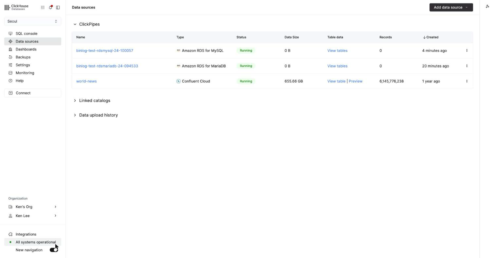
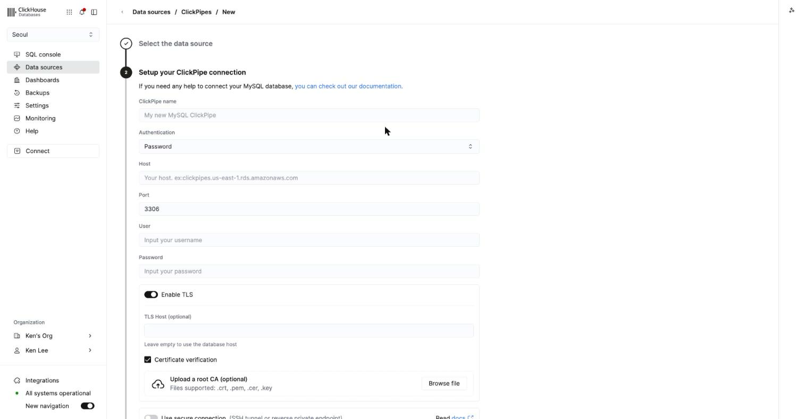
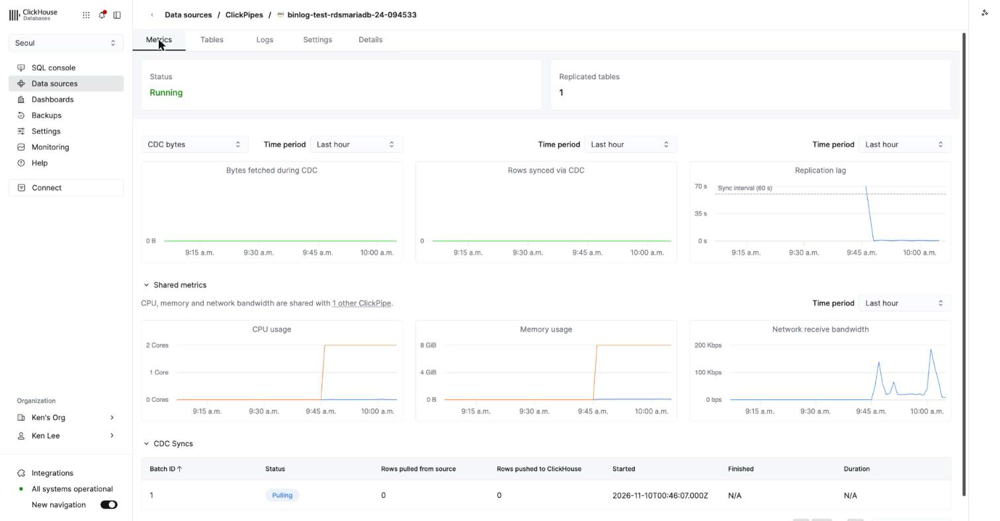
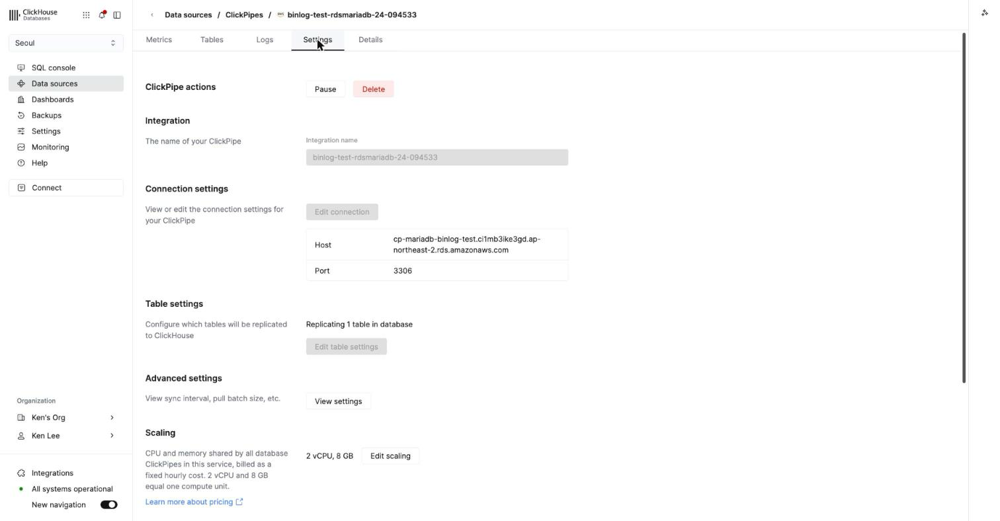
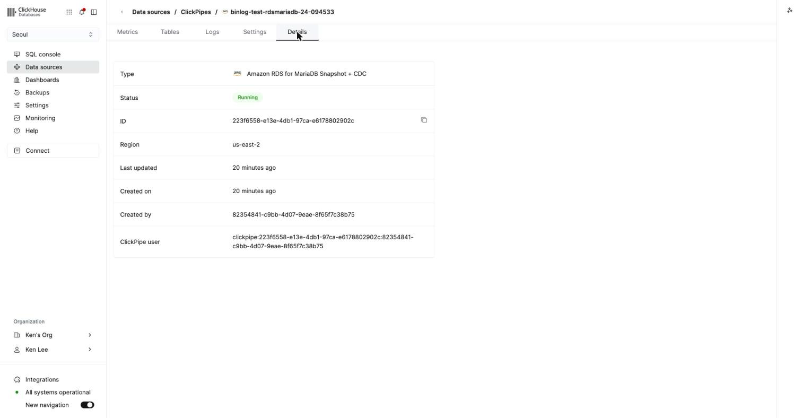
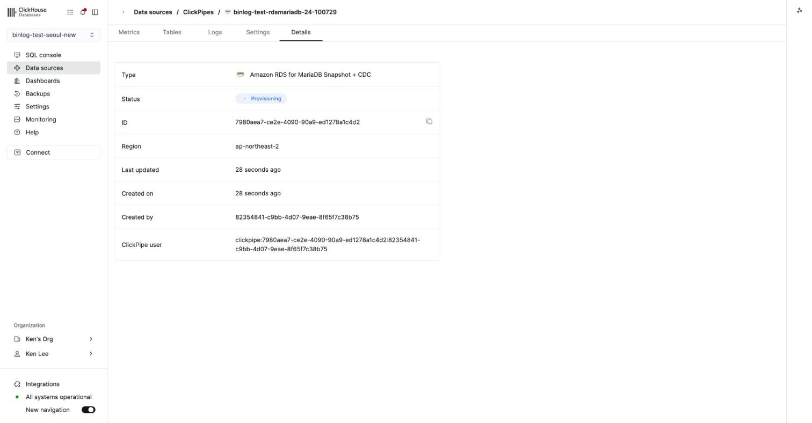

# RDS MariaDB as a ClickPipes MySQL CDC source — binlog retention and source setup

> **Last run: 2026-11-10** — AWS `ap-northeast-2`: RDS MariaDB 11.8.9 and 10.11.19, RDS MySQL 8.4.13 (`db.t4g.micro`), two ClickHouse Cloud services (ClickPipes in `us-east-2` and in `ap-northeast-2`), ClickPipes OpenAPI and Terraform `ClickHouse/clickhouse` 3.41.0 / 3.42.0. Steps ran by hand with the same commands; `02-source.sh` and `03-try-pipe.sh` then ran as files. `01-rds.sh` and `99-destroy.sh` were not run as files. Details: [`RUN-2026-11-10.md`](RUN-2026-11-10.md).
>
> **마지막 실행: 2026-11-10** — AWS `ap-northeast-2`: RDS MariaDB 11.8.9·10.11.19, RDS MySQL 8.4.13(`db.t4g.micro`), ClickHouse Cloud 서비스 2개(ClickPipes가 `us-east-2`인 것과 `ap-northeast-2`인 것), ClickPipes OpenAPI와 Terraform `ClickHouse/clickhouse` 3.41.0·3.42.0. 같은 명령으로 손으로 먼저 실행했고, 이어서 `02-source.sh`·`03-try-pipe.sh`를 파일 그대로 실행했다. `01-rds.sh`·`99-destroy.sh`는 파일로 실행하지 않았다. 자세한 기록: [`RUN-2026-11-10.md`](RUN-2026-11-10.md).

[English](#english) | [한국어](#한국어)

## English

> **Related notes**: [RDS MariaDB to ClickHouse Cloud with ClickPipes MySQL CDC](https://clickhouse.litkhai.dev/en/articles/cloud/clickpipes-rds-mariadb-cdc/)

Builds an RDS MariaDB source the way ClickPipes MySQL CDC expects it, then creates pipes with different retention values, source types and grants to see what the create call accepts.

### Answer

- **72 hours is the floor.** With the ClickPipes user able to read `mysql.rds_configuration`, `binlog retention hours` unset, 24 or 71 is rejected: `RDS/Aurora setting 'binlog retention hours' should be at least 72, currently 24`. 72 and 168 are accepted. RDS MySQL behaves the same.
- **Grant `SELECT ON mysql.rds_configuration`.** The create call reads the retention from that table; without access it skips the check and the pipe is created at any retention.
- **MariaDB needs `SLAVE MONITOR`** besides `REPLICATION CLIENT` and `REPLICATION SLAVE`: without it the create call fails with `ERROR 1227 … SLAVE MONITOR privilege` (11.8.9 and 10.11.19).
- **The source type must match the engine.** `rdsmysql` on MariaDB: `server appears to be MariaDB but MySQL source has been selected`; `rdsmariadb` on MySQL: the reverse.
- **Admit the IPs of the region the pipes run in.** The pipe's Details tab shows it. A service created on 2025-11-14 ran its pipes in `us-east-2`; one created on 2026-11-10 ran them in `ap-northeast-2`.

### Steps

```bash
cp env.example .env                 # fill in the OpenAPI key, ORG_ID, SERVICE_ID
./01-rds.sh                         # parameter group, security group, RDS MariaDB (~9 min)
./02-source.sh                      # schema, 1,000 rows, clickpipes_user and grants, retention 72
# create the destination database once, e.g. in the SQL console: CREATE DATABASE mariadb_cdc_lab
./03-try-pipe.sh rdsmariadb 24      # expect 400 … should be at least 72, currently 24
./03-try-pipe.sh rdsmariadb 72      # expect 200
./03-try-pipe.sh rdsmysql keep      # expect 400 … server appears to be MariaDB
./99-destroy.sh                     # pipes, RDS instance, parameter group, security group
```

`terraform/` has the same pipe as a `clickhouse_clickpipe` resource. In our run the apply created the pipe but ended with a provider error on `source.mysql.server_id` and left the resource tainted; `terraform untaint clickhouse_clickpipe.mariadb_cdc` cleared it (`RUN-2026-11-10.md`).

### Screens

| | |
|---|---|
|  |  |
|  |  |
|  |  |

### Cost

Three `db.t4g.micro` instances for under two hours and one extra 8 GiB ClickHouse Cloud service for under an hour; ClickPipes CDC compute (2 vCPU, 8 GB, shared by the service's database pipes) while pipes existed.

## 한국어

> **관련 노트**: [RDS MariaDB를 ClickPipes MySQL CDC로 ClickHouse Cloud에 옮기기](https://clickhouse.litkhai.dev/articles/cloud/clickpipes-rds-mariadb-cdc/)

ClickPipes MySQL CDC가 기대하는 대로 RDS MariaDB 소스를 만든 뒤, 보관 시간·소스 타입·권한을 바꿔 가며 파이프를 만들어 생성 호출이 무엇을 받아들이는지 본다.

### 답

- **하한은 72시간이다.** ClickPipes 사용자가 `mysql.rds_configuration`을 읽을 수 있으면 `binlog retention hours`가 미설정·24·71일 때 거부된다: `RDS/Aurora setting 'binlog retention hours' should be at least 72, currently 24`. 72와 168은 통과. RDS MySQL도 같다.
- **`SELECT ON mysql.rds_configuration`을 준다.** 생성 호출은 보관 시간을 이 테이블에서 읽는다. 읽지 못하면 검사를 건너뛰고 보관 시간과 상관없이 파이프가 만들어진다.
- **MariaDB는 `SLAVE MONITOR`가 필요하다.** `REPLICATION CLIENT`·`REPLICATION SLAVE`만으로는 `ERROR 1227 … SLAVE MONITOR privilege`로 실패한다(11.8.9, 10.11.19).
- **소스 타입은 엔진과 맞아야 한다.** MariaDB에 `rdsmysql`: `server appears to be MariaDB but MySQL source has been selected`, MySQL에 `rdsmariadb`: 반대 메시지.
- **파이프가 도는 리전의 IP를 연다.** 파이프 Details 탭에 나온다. 2025-11-14에 만든 서비스는 `us-east-2`, 2026-11-10에 만든 서비스는 `ap-northeast-2`였다.

### 순서

```bash
cp env.example .env                 # OpenAPI 키, ORG_ID, SERVICE_ID 입력
./01-rds.sh                         # 파라미터 그룹, 보안 그룹, RDS MariaDB (약 9분)
./02-source.sh                      # 스키마, 1,000행, clickpipes_user와 권한, 보관 72시간
# 대상 DB를 한 번 만든다. 예: SQL 콘솔에서 CREATE DATABASE mariadb_cdc_lab
./03-try-pipe.sh rdsmariadb 24      # 400 … should be at least 72, currently 24
./03-try-pipe.sh rdsmariadb 72      # 200
./03-try-pipe.sh rdsmysql keep      # 400 … server appears to be MariaDB
./99-destroy.sh                     # 파이프, RDS 인스턴스, 파라미터 그룹, 보안 그룹
```

`terraform/`에는 같은 파이프가 `clickhouse_clickpipe` 리소스로 있다. 이번 실행에서 apply는 파이프를 만들었지만 `source.mysql.server_id` provider 오류로 끝나 리소스가 tainted로 남았고, `terraform untaint clickhouse_clickpipe.mariadb_cdc`로 정리됐다(`RUN-2026-11-10.md`).

### 화면

위 English 절의 표와 같다.

### 비용

`db.t4g.micro` 3대를 2시간 이내, 8 GiB ClickHouse Cloud 서비스 하나를 1시간 이내 추가로 썼고, 파이프가 있는 동안 ClickPipes CDC 컴퓨트(2 vCPU, 8 GB, 서비스의 DB 파이프가 공유)가 돌았다.
