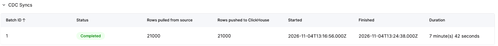
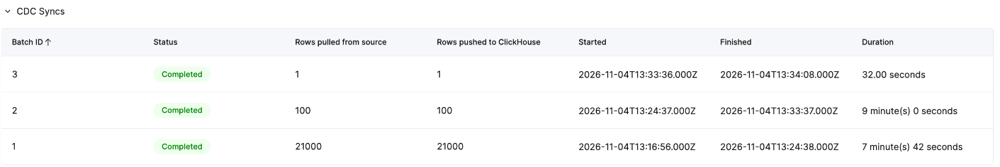
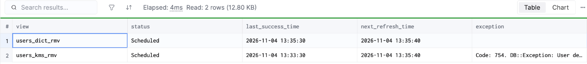
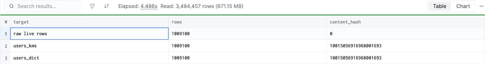

# ClickPipes Postgres CDC with KMS-protected values decrypted in refreshable materialized views

> **Last run: 2026-11-04** — every step ran once, one script at a time (12:52–13:50 UTC), then `destroy.sh`, on AWS `ap-northeast-2`: Aurora PostgreSQL 16.13 (`db.t4g.medium`, `rds.logical_replication = 1`), a new ClickHouse Cloud service (1 replica, 8 GiB, ClickHouse 26.6.1.2455), ClickPipes Postgres CDC (`syncIntervalSeconds` 10), a Python 3.11 executable UDF with `cryptography` from `requirements.txt` (`sandboxType: netenable`), refreshable MVs every 10 s. Terraform 1.16.4, `hashicorp/aws` 5.100.0, `create_udf_user = false` (the account's SCP denies `iam:CreateUser`). Step-by-step log with console captures: [`RUN-2026-11-04.md`](RUN-2026-11-04.md). Not run: PrivateLink for the source (Aurora was public, open only to the ClickPipes IPs), an IAM user for the UDF, sizing at production volume.
>
> **마지막 실행: 2026-11-04** — 스크립트를 하나씩 한 번 실행하고(12:52–13:50 UTC) `destroy.sh`까지 실행. AWS `ap-northeast-2`: Aurora PostgreSQL 16.13(`db.t4g.medium`, `rds.logical_replication = 1`), 새 ClickHouse Cloud 서비스(replica 1개, 8 GiB, ClickHouse 26.6.1.2455), ClickPipes Postgres CDC(`syncIntervalSeconds` 10), `requirements.txt`로 `cryptography`를 쓰는 Python 3.11 실행형 UDF(`sandboxType: netenable`), 10초마다 도는 refreshable MV. Terraform 1.16.4, `hashicorp/aws` 5.100.0, `create_udf_user = false`(계정 SCP가 `iam:CreateUser`를 막음). 콘솔 캡처가 있는 단계별 기록: [`RUN-2026-11-04.md`](RUN-2026-11-04.md). 실행하지 않은 것: 원본 쪽 PrivateLink(Aurora는 공개, ClickPipes IP에만 열어 둠), UDF용 IAM 사용자, 운영 규모 사이징.

[English](#english) | [한국어](#한국어)

## English

An application keeps users in PostgreSQL with sensitive values encrypted by AES-256-CBC under KMS-wrapped data keys — most of them inside a `jsonb` column — and today moves them with DMS → Kinesis → a Lambda that decrypts. This lab replaces that chain with **one ClickPipe** and decrypts inside ClickHouse Cloud, in **refreshable materialized views that run beside the pipe, not inside it**.

It is the second design. The first ([`../kms-decrypt-cdc`](../kms-decrypt-cdc/)) decrypted in views on the pipe's INSERT and found the weak spots: a failing or slow decryption held CDC, and its UDF handed the data key back to SQL. Every one of them is addressed here and measured.

```
Aurora PostgreSQL 16 ──ClickPipes CDC──> raw.users  (ciphertext + encrypted data key only)
                                            │  every 10 s, watermark + anti-join
                                            ├─ users_kms_rmv : kms_decrypt_row(edk, …) → app.users_kms   (key stays inside the UDF, KMS-bound)
                                            └─ users_dict_rmv: dictGet(plain key) + decrypt() → app.users_dict (key kept in ClickHouse)
```

### Why this design

- **One managed pipe instead of three services.** ClickPipes did the initial load of 1,000,000 rows (185 s from create to `Running`, 11 parallel partitions) and keeps CDC lag near its 10 s sync interval, with batches, rows and lag in the console. No DMS task, no Kinesis stream, no Lambda to run or patch.
- **Decryption can never stop CDC.** Nothing runs on the pipe's INSERT. A CDC batch carrying 10,000 new per-row keys completed in 11 s (the first design held the same batch 4 min 20 s). With the UDF's credentials broken, both new CDC batches still completed and replication lag stayed at the sync interval; only the decrypted table waited.
- **It heals itself.** A failed refresh keeps its watermark, so the next refresh retries the same rows. After a fixed UDF was published, the decrypted table was complete again with **no row lost** — 1,009,100 rows, identical in both paths, every field equal to the original plaintext.
- **The key never reaches SQL.** `kms_decrypt_row` returns plaintext only; the data key is unwrapped by KMS inside the UDF process and stays there. Called with a key blob and no ciphertext it returns empty fields.
- **Stolen UDF credentials are useless.** The UDF principal may call `kms:Decrypt` only from ClickHouse Cloud's egress IPs for the region. The same credentials from a laptop: `AccessDeniedException`. CloudTrail shows all 10,024 successful calls from the service's egress IP.
- **Ciphertext at the CDC layer, plaintext only where it is served.** `raw.users` holds ciphertext and encrypted keys; the serving tables are behind ordinary grants; a restricted user is denied `raw.users` and the key table.
- **Two key options on the same pipe.** Keys via KMS inside the UDF, or plaintext keys in a grant-protected dictionary (faster: the snapshot was decrypted 32 s after it landed, CDC changes in under 3 s).
- **Observable.** `system.view_refreshes` (status, exception), a lag query, and `query_log` showing who called the UDF.

### Results (2026-11-04)

| Step | Measured |
|---|---|
| Initial load, ClickPipe create → `Running` | 185 s; raw.users at 1,000,000 rows at 13:17:04 |
| Snapshot decrypted, dictionary path | 13:17:36 (32 s after raw) |
| Snapshot decrypted, KMS-in-UDF path | 13:19:31 (2 min 27 s after raw); one refresh took 113.6 s for 1,000,000 rows (≈8,800 rows/s, Python `cryptography` + JSON) |
| Correct rows after the snapshot | 1,000,000 / 1,000,000 in both (properties, email, phone); every property path `String` |
| CDC: 10,000 updates with rotated keys, 1,000 deletes, 10,000 users with a key each — commit 13:24:27 | ClickPipes batch `Completed` 13:24:38; raw and dictionary path 13:24:46; KMS path 13:29:18 (10,000 KMS calls in the refresh, 271 s) |
| Rows written per path for that change | 21,000 each — no row decrypted twice |
| Correct rows after CDC | 1,009,000 / 1,009,000 in both; deleted users hidden by `FINAL` |
| Broken UDF credentials (13:33:09) → 100 new users, 1 update | CDC batches 2 and 3 `Completed` (13:33:37, 13:34:08); raw and dictionary path current; KMS path held, `Code: 754` in `system.view_refreshes` |
| Recovery: republish the UDF (build + attach + reload) | 210 s; KMS path complete immediately after; final 1,009,100 rows, same content hash in both paths |
| KMS `Decrypt` by the UDF role (CloudTrail) | 10,025: 10,024 from the service's egress IP, 1 `AccessDenied` (the laptop test) |
| AWS cost (Price List × usage) | ≈ $0.2: Aurora `db.t4g.medium` $0.113/h × ≈1 h, ≈20,000 KMS requests |









### Mitigations built in

**On the ClickPipes side**

| Risk | Mitigation here | Checked |
|---|---|---|
| A slow or failing decryption holds CDC | No view on the pipe's INSERT; ClickPipes lands ciphertext only | per-row keys and broken UDF: batches completed |
| Plaintext copies at the CDC layer | `raw.users` holds ciphertext + encrypted data keys only; grants keep serving users out | analyst denied `raw.users` (`Code: 497`) |
| Source reachable from the internet | Aurora security group open to the six ClickPipes ap-northeast-2 IPs + one operator /32; production: PrivateLink / reverse private endpoint | SG rules recorded; PrivateLink not run |
| Over-privileged replication user | `clickpipes_user` with `SELECT` + `rds_replication`; publication on `users` only | as created by `pg/01-schema.sql` |
| Deletes without the encrypted key | `REPLICA IDENTITY FULL` (delete events carry `edk`); the UDF also returns empty fields for a row without a key | 1,000 deletes hidden by `FINAL` |

**On the materialized-view side**

| Risk | Mitigation here | Checked |
|---|---|---|
| Skipping a late-committed insert | Watermark on `_peerdb_synced_at` with a 1-minute overlap | all rows present after parallel initial load |
| Re-decrypting the overlap forever | Anti-join on `(user_id, _peerdb_version)` inside the window | before: every refresh re-decrypted the 1,000,000-row snapshot (113.6 s); after: idle refresh ≈1 s, 21,000 rows written for 21,000 changes |
| Failure loses rows | Failed refresh leaves the watermark; next refresh retries | 100 users + 1 update decrypted after recovery, none lost |
| Data key exposed to SQL | UDF returns plaintext only, key cached inside the process | `kms_decrypt_row(edk, '', '', '{}')` → empty fields |
| UDF credentials copied out of the zip | `aws:SourceIp` = ClickHouse Cloud egress IPs on the KMS permission | laptop: `AccessDeniedException` |
| Credentials expire (no IAM user allowed) | 1-hour STS credentials; `udf-deploy.sh` republishes a version; refreshes resume by themselves | republish 210 s, no manual catch-up |
| First UDF attach restarts the service | Refreshes that ran on the old pod failed (`UNKNOWN_FUNCTION`) and succeeded once the rolling restart ended | self-healed, no action |
| Dates re-typed when cast to JSON | `CAST(…, 'JSON')` inside the SELECT with date inference off | every path `String` |
| Nobody notices a stalled refresh | `sql/60-monitor.sql`: `system.view_refreshes` exception, seconds behind raw, rows missing | `behind_raw_s` 570 during the failure |
| Someone calls the UDF directly | `query_log.used_executable_user_defined_functions` lists callers for audit/alerting | refresh 104, default 7, analyst 3 |
| Plain keys in the dictionary path | Key table and dictionary behind grants, keys loaded as data (not SQL text), key id = `SHA256(edk)` so rotation adds a key | analyst denied `keys.plain_keys` |

**What is still true**

- An executable UDF has no grant of its own. A user who already holds a ciphertext row (edk + value) can call `kms_decrypt_row` and get its plaintext — the analyst did, with a row copied from outside. The key itself is never returned. Keep `raw.users` restricted and alert on UDF callers other than the refresh.
- KMS-in-UDF decryption runs at ≈8,800 rows/s per refresh here. That is far above a CDC rate of hundreds of rows/s, but an initial load of tens of millions of rows takes hours on this path; the dictionary path did 1,000,000 rows in about 30 s. One data key per row costs one KMS call per row (≈37/s observed in the first design); one key per tenant costs one call per process.

### Run it

```bash
cp terraform/terraform.tfvars.example terraform/terraform.tfvars   # owner, ttl, your /32; create_udf_user = false; udf_allowed_source_ips = ClickHouse Cloud egress IPs
export CHC_KEY=… CHC_SECRET=… ORG_ID=… SERVICE_ID=… CH_HOST=… CH_USER=default CH_PASSWORD=…   # a test service in ap-northeast-2
export UDF_ROLE_ARN=…        # terraform output udf_role_arn
./deploy.sh                  # or the steps one by one, as in RUN-2026-11-04.md
./cdc-changes.sh             # updates with rotated keys, deletes, per-row keys
./destroy.sh                 # pipe, UDF, databases, Terraform; delete the test service yourself
```

## 한국어

애플리케이션이 유저를 PostgreSQL에 두고, 민감한 값을 KMS가 감싼 데이터 키로 AES-256-CBC 암호화한다. 암호화된 값은 대부분 `jsonb` 컬럼 안에 있다. 지금은 DMS → Kinesis → 복호화 Lambda로 옮긴다. 이 실습은 그 체인을 **ClickPipe 하나**로 바꾸고, ClickHouse Cloud 안에서 푼다. 복호화는 **파이프 안이 아니라 파이프 옆에서 도는 refreshable materialized view**가 맡는다.

두 번째 설계다. 첫 설계([`../kms-decrypt-cdc`](../kms-decrypt-cdc/))는 파이프의 INSERT에 붙은 뷰에서 풀었고, 약점을 찾았다. 복호화가 실패하거나 느리면 CDC가 멈췄고, UDF가 데이터 키를 SQL로 돌려줬다. 여기서는 그 약점을 하나씩 막고 실측했다.

```
Aurora PostgreSQL 16 ──ClickPipes CDC──> raw.users  (암호문 + 암호화된 데이터 키만)
                                            │  10초마다, 워터마크 + anti-join
                                            ├─ users_kms_rmv : kms_decrypt_row(edk, …) → app.users_kms   (키는 UDF 안에만, KMS 호출은 Cloud IP에서만)
                                            └─ users_dict_rmv: dictGet(평문 키) + decrypt() → app.users_dict (키를 ClickHouse에 둠)
```

### 이 설계의 강점

- **서비스 셋 대신 관리형 파이프 하나.** ClickPipes가 1,000,000행 초기 적재를 했고(생성 → `Running` 185초, 파티션 11개 병렬), CDC 지연은 동기화 간격(10초) 근처로 유지된다. 배치·행 수·지연은 콘솔에서 본다. 운영하거나 패치할 DMS 작업, Kinesis 스트림, Lambda가 없다.
- **복호화가 CDC를 멈추지 못한다.** 파이프의 INSERT에는 아무것도 붙어 있지 않다. 행마다 키가 다른 유저 1만 명이 든 CDC 배치가 11초 만에 완료됐다(첫 설계에서는 같은 배치가 4분 20초 묶였다). UDF 자격 증명이 깨졌을 때도 새 CDC 배치 둘이 모두 완료됐고 복제 지연은 동기화 간격에 머물렀다. 기다린 것은 복호화 테이블뿐이다.
- **스스로 복구한다.** 실패한 refresh는 워터마크를 그대로 두므로 다음 refresh가 같은 행을 다시 시도한다. 고친 UDF를 배포하자 복호화 테이블이 **빠진 행 없이** 다시 채워졌다. 1,009,100행이 두 경로에서 같고, 모든 필드가 원래 평문과 같다.
- **키가 SQL에 나오지 않는다.** `kms_decrypt_row`는 평문만 돌려준다. 데이터 키는 UDF 프로세스 안에서 KMS로 풀리고 거기 머문다. 암호문 없이 키 덩어리만 넣고 부르면 빈 값이 나온다.
- **UDF 자격 증명이 새어도 쓸 수 없다.** UDF 주체는 해당 리전의 ClickHouse Cloud egress IP에서만 `kms:Decrypt`를 할 수 있다. 같은 자격 증명을 노트북에서 쓰면 `AccessDeniedException`이다. CloudTrail에서 성공한 호출 10,024번은 모두 서비스 egress IP에서 왔다.
- **CDC 층에는 암호문만, 평문은 서비스하는 곳에만.** `raw.users`에는 암호문과 암호화된 키만 있다. 서비스 테이블은 평범한 권한 뒤에 있고, 제한된 사용자는 `raw.users`와 키 테이블에서 거부된다.
- **같은 파이프에 키 방식 둘.** UDF 안에서 KMS로 받는 방식, 또는 권한으로 보호한 딕셔너리에 평문 키를 두는 방식(더 빠름: 스냅샷은 들어온 지 32초 뒤 복호화, CDC 변경은 3초 안).
- **관찰할 수 있다.** `system.view_refreshes`(상태, 예외), 지연 쿼리, UDF를 누가 불렀는지 보여 주는 `query_log`.

### 결과 (2026-11-04)

| 단계 | 측정 |
|---|---|
| 초기 적재, ClickPipe 생성 → `Running` | 185초. raw.users 1,000,000행 도달 13:17:04 |
| 스냅샷 복호화, 딕셔너리 경로 | 13:17:36 (raw 뒤 32초) |
| 스냅샷 복호화, UDF 안 KMS 경로 | 13:19:31 (raw 뒤 2분 27초). refresh 한 번이 1,000,000행에 113.6초(초당 약 8,800행, Python `cryptography` + JSON) |
| 스냅샷 뒤 정답 행 | 두 경로 모두 1,000,000 / 1,000,000(properties, email, phone). 모든 속성 경로 `String` |
| CDC: 키를 바꾼 갱신 10,000건, 삭제 1,000건, 행마다 키 10,000명 — 커밋 13:24:27 | ClickPipes 배치 `Completed` 13:24:38. raw와 딕셔너리 경로 13:24:46. KMS 경로 13:29:18(refresh 안에서 KMS 호출 1만 번, 271초) |
| 그 변경에서 경로별로 쓴 행 | 각 21,000 — 두 번 복호화된 행 없음 |
| CDC 뒤 정답 행 | 두 경로 모두 1,009,000 / 1,009,000. 삭제된 유저는 `FINAL`이 숨김 |
| UDF 자격 증명 깨짐(13:33:09) → 새 유저 100명, 갱신 1건 | CDC 배치 2·3 `Completed`(13:33:37, 13:34:08). raw와 딕셔너리 경로는 최신. KMS 경로만 대기, `system.view_refreshes`에 `Code: 754` |
| 복구: UDF 다시 배포(빌드 + 붙이기 + reload) | 210초. 직후 KMS 경로 완성. 최종 1,009,100행, 두 경로 내용 해시 같음 |
| UDF 역할의 KMS `Decrypt`(CloudTrail) | 10,025번: 10,024번은 서비스 egress IP, 1번 `AccessDenied`(노트북 테스트) |
| AWS 비용(Price List × 사용량) | 약 $0.2: Aurora `db.t4g.medium` 시간당 $0.113 × 약 1시간, KMS 요청 약 20,000건 |


### 넣어 둔 보완책

**ClickPipes 쪽**

| 위험 | 이 실습의 보완책 | 확인 |
|---|---|---|
| 복호화가 느리거나 실패하면 CDC가 멈춤 | 파이프 INSERT에 뷰를 두지 않음. ClickPipes는 암호문만 적재 | 행마다 키, UDF 고장: 배치 모두 완료 |
| CDC 층의 평문 사본 | `raw.users`에는 암호문 + 암호화된 데이터 키만. 서비스 사용자는 권한으로 차단 | analyst가 `raw.users`에서 거부(`Code: 497`) |
| 인터넷에서 닿는 원본 | Aurora 보안 그룹은 ClickPipes 서울 IP 6개 + 운영자 /32만. 운영에서는 PrivateLink / reverse private endpoint | SG 규칙 기록. PrivateLink는 실행 안 함 |
| 권한이 넓은 복제 사용자 | `clickpipes_user`에 `SELECT` + `rds_replication`만, publication은 `users`만 | `pg/01-schema.sql` 그대로 |
| 암호화된 키 없이 오는 삭제 | `REPLICA IDENTITY FULL`(삭제 이벤트에 `edk`가 실림). 키 없는 행에는 UDF가 빈 값을 돌려줌 | 삭제 1,000건을 `FINAL`이 숨김 |

**materialized view 쪽**

| 위험 | 이 실습의 보완책 | 확인 |
|---|---|---|
| 늦게 커밋된 INSERT를 건너뜀 | `_peerdb_synced_at` 워터마크에 1분 겹침 | 병렬 초기 적재 뒤 모든 행 존재 |
| 겹치는 구간을 계속 다시 복호화 | 그 구간 안에서 `(user_id, _peerdb_version)` anti-join | 전: refresh마다 100만 행 스냅샷을 다시 복호화(113.6초). 후: 할 일 없는 refresh 약 1초, 변경 21,000건에 21,000행 |
| 실패하면 행을 잃음 | 실패한 refresh는 워터마크를 그대로 두고 다음 refresh가 다시 시도 | 복구 뒤 유저 100명 + 갱신 1건 복호화, 빠진 것 없음 |
| 데이터 키가 SQL에 노출 | UDF는 평문만 돌려주고 키는 프로세스 안에 캐시 | `kms_decrypt_row(edk, '', '', '{}')` → 빈 값 |
| zip 밖으로 복사된 UDF 자격 증명 | KMS 권한에 `aws:SourceIp` = ClickHouse Cloud egress IP | 노트북: `AccessDeniedException` |
| 자격 증명 만료(IAM 사용자 불가) | 1시간 STS 자격 증명. `udf-deploy.sh`가 새 버전을 배포하고 refresh는 알아서 재개 | 재배포 210초, 손으로 따라잡을 일 없음 |
| 첫 UDF를 붙이면 서비스 재시작 | 옛 pod에서 돈 refresh는 실패(`UNKNOWN_FUNCTION`), 순차 재시작이 끝나자 성공 | 스스로 복구, 조치 없음 |
| JSON으로 바꿀 때 날짜 타입이 바뀜 | SELECT 안에서 `CAST(…, 'JSON')`, 날짜 추론 끔 | 모든 경로 `String` |
| 멈춘 refresh를 아무도 모름 | `sql/60-monitor.sql`: `system.view_refreshes` 예외, raw보다 몇 초 뒤처졌는지, 빠진 행 수 | 장애 중 `behind_raw_s` 570 |
| 누군가 UDF를 직접 부름 | `query_log.used_executable_user_defined_functions`로 호출자를 감사·알림 | refresh 104, default 7, analyst 3 |
| 딕셔너리 경로의 평문 키 | 키 테이블·딕셔너리는 권한 뒤에, 키는 SQL 문장이 아니라 데이터로 넣음, 키 id = `SHA256(edk)`라 교체하면 키가 추가됨 | analyst가 `keys.plain_keys`에서 거부 |

**여전히 남는 것**

- 실행형 UDF에는 자체 권한이 없다. 암호문 행(edk + 값)을 이미 가진 사용자는 `kms_decrypt_row`를 불러 그 평문을 얻을 수 있다. analyst도 밖에서 복사한 행으로 그렇게 했다. 키 자체는 돌려주지 않는다. `raw.users`를 제한하고, refresh 말고 UDF를 부르는 호출자에 알림을 건다.
- UDF 안 KMS 경로의 복호화는 여기서 refresh당 초당 약 8,800행이다. 초당 수백 건인 CDC에는 충분하지만, 수천만 행 초기 적재는 이 경로로 몇 시간 걸린다. 딕셔너리 경로는 100만 행을 약 30초에 했다. 행마다 데이터 키가 다르면 행마다 KMS 호출이 한 번씩 든다(첫 설계에서 초당 약 37번). 테넌트마다 키 하나면 프로세스당 한 번이다.

### 실행

```bash
cp terraform/terraform.tfvars.example terraform/terraform.tfvars   # owner, ttl, 내 /32. create_udf_user = false. udf_allowed_source_ips = ClickHouse Cloud egress IP
export CHC_KEY=… CHC_SECRET=… ORG_ID=… SERVICE_ID=… CH_HOST=… CH_USER=default CH_PASSWORD=…   # ap-northeast-2의 테스트 서비스
export UDF_ROLE_ARN=…        # terraform output udf_role_arn
./deploy.sh                  # 또는 RUN-2026-11-04.md처럼 단계별로
./cdc-changes.sh             # 키를 바꾼 갱신, 삭제, 행마다 키
./destroy.sh                 # 파이프, UDF, 데이터베이스, Terraform. 테스트 서비스는 직접 지운다
```
