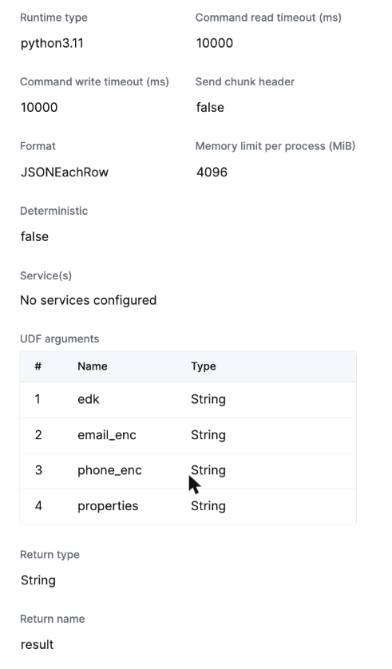
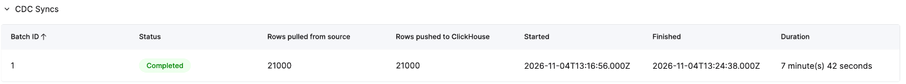
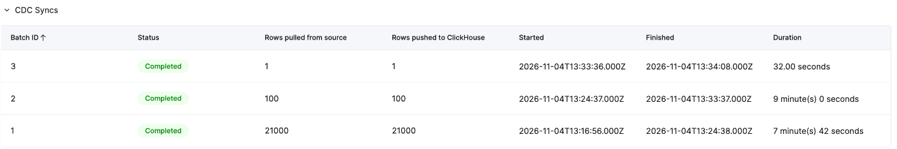
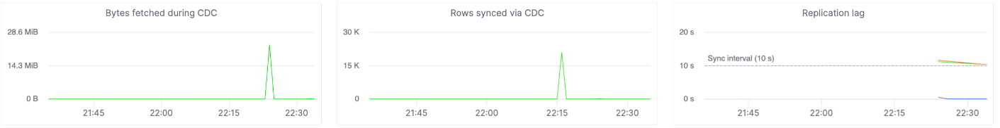
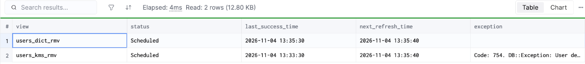
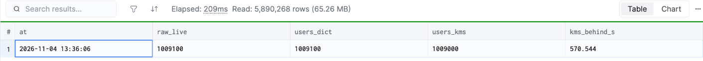
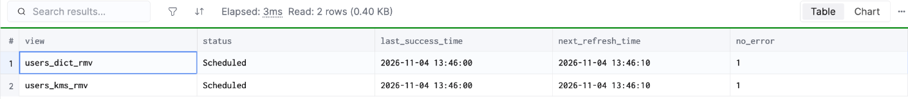
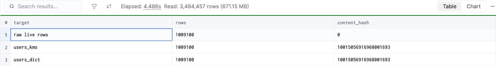
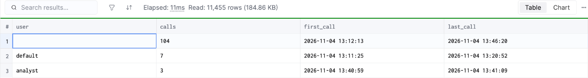

# Run log, 2026-11-04

[English](#english) | [한국어](#한국어)

## English

The run behind the [README](README.md), step by step, times in UTC. Passwords, hosts, keys and account IDs are masked; the data is synthetic. `deploy.sh` holds the same steps in a tidier order (pipe first, refreshable MVs after it); this run created the MVs earlier, which is how the first refreshes met a missing table and a restarting pod and recovered on their own.

### 1. AWS (12:52:30 → 12:59)

`terraform apply`: 17 resources, the Aurora writer in 5 min 48 s. A second apply added the source-IP condition to the UDF role (`out/aws-state.txt`, masked):

```
Effect Allow · Action kms:Decrypt · Resource arn:aws:kms:ap-northeast-2:<account>:key/<key-id>
Condition IpAddress aws:SourceIp = 13.125.171.49/32, 3.34.229.201/32, 3.36.186.37/32, 43.202.136.145/32, 43.202.180.247/32, 43.203.109.145/32, 54.116.10.168/32
```

The role's STS credentials used from the operator's laptop: `AccessDeniedException` (CloudTrail: 1 `AccessDenied` from the operator IP).

### 2. Data

1,000,000 users, 8 data keys (`GenerateDataKey` 8 calls), generation 58.4 s, generation + `COPY` 102 s. Local rehearsal of the UDF on clickhouse local 26.9.6.6 with real KMS: 10,000 of 10,000 rows correct, every property `String`.

### 3. UDF `kms_decrypt_row` (13:02:46 → 13:10:55)

Zip of 3,124 bytes: `main.py`, `requirements.txt` (`cryptography>=43`), `config.json` with 1-hour STS credentials. JSONEachRow, `executable_pool` of 3, return name `result`.



The trailing `SYSTEM RELOAD FUNCTION ON CLUSTER` failed on the pod being replaced by the rolling restart (`external user defined function … not found`); the new pod had the function. One real row decrypted through the UDF returned the right email and name.

### 4. Refreshable MVs and the ClickPipe (13:12 → 13:19:31)

The first refreshes of `users_kms_rmv` failed with `UNKNOWN_FUNCTION` while the old pod was still serving; once it was gone (13:13:20) both refreshes succeeded with no action. `raw.users` was then dropped so that ClickPipes created it; the pipe went from create to `Running` in 185 s.

```
13:16:42 raw/kms/dict  363810         0        0
13:16:53               727620         0   363810
13:17:04              1000000         0   363810
13:17:36              1000000    363810  1000000     # dictionary path complete, 32 s after raw
13:19:31              1000000   1000000  1000000     # KMS-in-UDF path complete
users_kms  1000000 1000000 1000000 1000000           # rows, props_ok, email_ok, phone_ok
users_dict 1000000 1000000 1000000 1000000
```

Found and fixed during the run: with only the 1-minute overlap, every KMS refresh re-decrypted the whole snapshot (2 refreshes, average 80 s, maximum 113.6 s, 1,363,810 rows written for 1,000,000). The anti-join on `(user_id, _peerdb_version)` stopped it; idle refreshes took about 1 s after that.

### 5. CDC changes (commit 13:24:27)

10,000 updates with 8 rotated keys, 1,000 deletes, 10,000 users with a data key each.

```
13:24:46 raw/kms/dict 1009000 1000000 1009000
13:29:18              1009000 1009000 1009000
refreshes writing those 21,000 rows: kms 8 (max 271,091 ms), dict 35 (max 2,779 ms), 21,000 rows each
users_kms  1009000 1009000 0 0 1009000               # expected_live, rows, unexpected, deleted_still_visible, all_fields_ok
users_dict 1009000 1009000 0 0 1009000
```



### 6. Broken UDF credentials (13:30 → 13:39:56)

Version 2 with invalid credentials (build 123 s, attach 47 s, reload 13:33:09). 100 users with a new key at 13:33:27, one update at 13:33:57.

```
raw.users new users 100 · users_dict 100 + the update · users_kms 0
system.view_refreshes: users_kms_rmv  Code: 754 … User defined function 'kms_decrypt_row' failed
behind_raw_s (kms) 570 at 13:36:06
```









Recovery: `udf-deploy.sh` published version 3 (13:36:26 → deployed and reloaded, 210 s); the KMS path had the 100 users and the update at 13:39:56. The only row that differs from the expected values is the probe update itself (the expected table was not told about it).





### 7. Access and audit

A user `analyst` with `GRANT SELECT ON app.users_kms` only (`out/exposure.txt`):

```
SELECT count() FROM app.users_kms                → 1009100
SELECT count() FROM raw.users                    → Code: 497
SELECT count() FROM keys.plain_keys              → Code: 497
kms_decrypt_row('<edk>', '', '', '{}')           → {"email": "", "phone": "", "properties": {}}   # no key comes back
kms_decrypt_row(<a full row copied from raw>)    → user0@example.com                             # possible only with a ciphertext row
```



CloudTrail, KMS `Decrypt` by the UDF role since 12:55: 10,025 — 10,024 from the service's egress IP 3.36.186.37 (2,414–2,442 per minute while the 10,000 per-row keys were unwrapped), 1 `AccessDenied` from the operator IP.

### 8. Teardown

`destroy.sh`: ClickPipe deleted, UDF detached and deleted, lab databases and `analyst` dropped, `terraform destroy`; the test service stopped and deleted with the Cloud API; the KMS key pending deletion (7 days).

## 한국어

[README](README.md)의 근거가 된 실행을 단계별로 적었다. 시각은 UTC다. 비밀번호·호스트·키·계정 ID는 가렸고, 데이터는 합성이다. `deploy.sh`는 같은 단계를 더 깔끔한 순서(파이프 먼저, refreshable MV는 그 뒤)로 담았다. 이번 실행은 MV를 먼저 만들었고, 그래서 첫 refresh들이 테이블이 아직 없거나 재시작 중인 pod를 만났다가 스스로 복구했다.

### 1. AWS (12:52:30 → 12:59)

`terraform apply`로 리소스 17개를 만들었고 Aurora writer에 5분 48초가 걸렸다. 두 번째 apply로 UDF 역할에 출발지 IP 조건을 넣었다. 허용은 실습 키에 대한 `kms:Decrypt`뿐이고, 조건은 ClickHouse Cloud 서울 egress IP 7개다. 이 역할의 STS 자격 증명을 운영자 노트북에서 쓰면 `AccessDeniedException`이 났다(CloudTrail에도 운영자 IP의 `AccessDenied` 1건).

### 2. 데이터

유저 1,000,000명, 데이터 키 8개(`GenerateDataKey` 8번). 생성 58.4초, 생성 + `COPY` 102초. UDF를 clickhouse local 26.9.6.6에서 실제 KMS로 미리 돌려 10,000행 모두 정답, 모든 속성 `String`.

### 3. UDF `kms_decrypt_row` (13:02:46 → 13:10:55)

zip 3,124바이트: `main.py`, `requirements.txt`(`cryptography>=43`), 1시간 STS 자격 증명을 담은 `config.json`. 형식은 JSONEachRow, `executable_pool` 3개, 반환 이름 `result`.


마지막 `SYSTEM RELOAD FUNCTION ON CLUSTER`는 순차 재시작으로 교체되던 pod에서 실패했다(`external user defined function … not found`). 새 pod에는 함수가 있었다. 실제 행 하나를 UDF로 풀어 email과 이름이 맞게 나왔다.

### 4. refreshable MV와 ClickPipe (13:12 → 13:19:31)

옛 pod가 아직 응답하는 동안 `users_kms_rmv`의 첫 refresh들은 `UNKNOWN_FUNCTION`으로 실패했다. 옛 pod가 사라지자(13:13:20) 두 refresh 모두 조치 없이 성공했다. 그다음 `raw.users`를 지워 ClickPipes가 직접 만들게 했고, 파이프는 생성에서 `Running`까지 185초였다. raw는 13:17:04에 100만 행, 딕셔너리 경로는 32초 뒤 13:17:36, UDF 안 KMS 경로는 13:19:31에 다 찼다. 두 경로 모두 1,000,000 / 1,000,000이 정답이었다.

실행 중 찾아 고친 것: 1분 겹침만 두자 KMS refresh가 매번 스냅샷 전체를 다시 복호화했다(refresh 2번, 평균 80초, 최대 113.6초, 100만 행에 1,363,810행 기록). `(user_id, _peerdb_version)` anti-join으로 멈췄고, 그 뒤 할 일 없는 refresh는 약 1초였다.

### 5. CDC 변경 (커밋 13:24:27)

키 8개를 바꾼 갱신 10,000건, 삭제 1,000건, 행마다 키가 하나인 유저 10,000명. raw와 딕셔너리 경로는 13:24:46, KMS 경로는 13:29:18에 반영됐다. 이 21,000행을 쓴 refresh는 KMS 8번(최대 271초), 딕셔너리 35번(최대 2.8초)이고, 경로마다 21,000행씩 썼다. 두 경로 모두 1,009,000 / 1,009,000이 정답이었다.


### 6. UDF 자격 증명이 깨졌을 때 (13:30 → 13:39:56)

잘못된 자격 증명으로 2버전을 배포했다(빌드 123초, 붙이기 47초, reload 13:33:09). 13:33:27에 새 키 유저 100명, 13:33:57에 갱신 1건을 넣었다. raw와 딕셔너리 경로에는 유저 100명과 갱신이 들어왔고, KMS 경로에는 없었다. `system.view_refreshes`에는 `users_kms_rmv`의 `Code: 754`가 남았다. 13:36:06 기준 KMS 경로는 raw보다 570초 뒤처졌다.


복구: `udf-deploy.sh`로 3버전을 배포했고(13:36:26 → 배포와 reload까지 210초), 13:39:56에 KMS 경로에 유저 100명과 갱신이 들어왔다. 정답과 다른 행은 일부러 넣은 갱신 하나뿐이다(정답 테이블에는 반영하지 않았다).


### 7. 접근과 감사

`app.users_kms`에 `SELECT`만 받은 `analyst`로 확인했다. `raw.users`와 `keys.plain_keys`는 `Code: 497`로 거부됐다. `kms_decrypt_row('<edk>', '', '', '{}')`는 빈 값만 돌려줘서 키가 나오지 않았다. raw에서 복사한 행 전체를 넣으면 그 평문은 나온다. 암호문 행을 가진 경우에만 가능하다.


CloudTrail에서 12:55 이후 UDF 역할의 KMS `Decrypt`는 10,025번이었다. 10,024번은 서비스 egress IP 3.36.186.37에서 왔고(행마다 키 1만 개를 푸는 동안 분당 2,414~2,442번), 1번은 운영자 IP의 `AccessDenied`다.

### 8. 정리

`destroy.sh`: ClickPipe 삭제, UDF 떼고 삭제, 실습 데이터베이스와 `analyst` 삭제, `terraform destroy`. 테스트 서비스는 Cloud API로 멈춘 뒤 삭제했고, KMS 키는 삭제 대기(7일)다.
