# Run log, 2026-11-04 (second run, with console captures)

[English](#english) | [한국어](#한국어)

## English

The lab's second end-to-end run, step by step: the command, what it printed, and a capture of the ClickHouse Cloud console where the step has a screen. The first run the same day produced the numbers in the [README](README.md); this one repeats it to record the process. Times are UTC. Passwords, hosts, keys and account IDs are masked or cropped out; the data is synthetic.

Environment: AWS `ap-northeast-2`, Aurora PostgreSQL 16.13 `db.t4g.medium`, a new ClickHouse Cloud service (1 replica, 8 GiB, ClickHouse 26.6.1.2455), Terraform 1.16.4 with `hashicorp/aws` 5.100.0, `create_udf_user = false` (the account's SCP denies `iam:CreateUser`). The AWS console was not signed in, so AWS state is shown as CLI output.

### 1. AWS: Terraform (10:58:17 → 11:05:33)

`terraform apply` created 17 resources; the Aurora writer took 5 min 58 s. State afterwards (`out/aws-state.txt`, masked):

```
Engine aurora-postgresql · EngineVersion 16.13 · Status available · StorageEncrypted True
Class db.t4g.medium · Public True · Status available
rds.logical_replication = 1 (pending-reboot, set in the cluster parameter group at creation)
KMS key: CUSTOMER · SYMMETRIC_DEFAULT · ENCRYPT_DECRYPT · Enabled
UDF role inline policy: Allow kms:Decrypt on arn:aws:kms:ap-northeast-2:<account>:key/<key-id>
Aurora SG 5432: the six ClickPipes ap-northeast-2 IPs + the operator /32
```

### 2. Data: 1,000,000 users, 8 data keys

```
$ uv run --with boto3 --with cryptography gen.py --users 1000000 --tenants 8 --name run
users=1000000 tenants=8 key_mode=tenant GenerateDataKey calls=8 seconds=49.8
$ pg.py -f pg/01-schema.sql ; COPY users FROM STDIN      # 36 s
count 1000000 · distinct edk 8 · 812 MB
```

### 3. ClickHouse Cloud: the test service

Created with the Cloud API (`POST /v1/organizations/{org}/services`, 1 replica, 8 GiB, IP access list = the operator /32). The SQL functions, target tables, plaintext keys for path B and the expected values were loaded with `clickhouse client` (`sql/10-functions.sql`, `sql/20-targets.sql`).

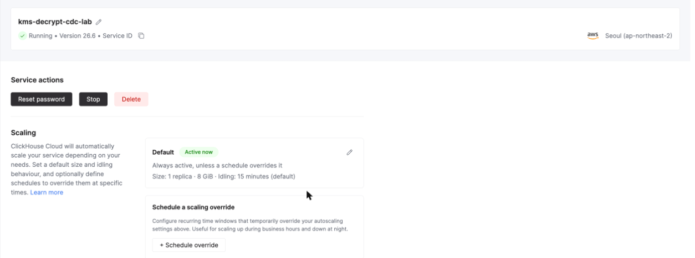

### 4. UDF `kms_unwrap` (11:01:48 → 11:10:04)

`udf-deploy.sh`: zip (`main.py` + `config.json` with 1-hour STS credentials from the role, 2,593 bytes) → `POST /udfUploads/url` → `PUT` → `POST /udfs` → build → `PUT /udfs/kms_unwrap/attachments/{service}`. The first attachment restarts the service (rolling).

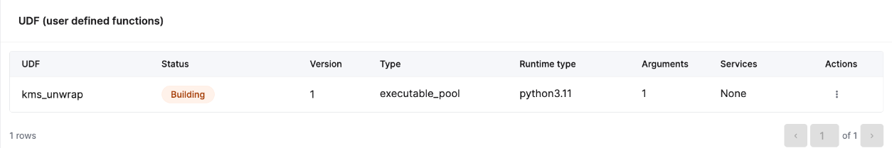

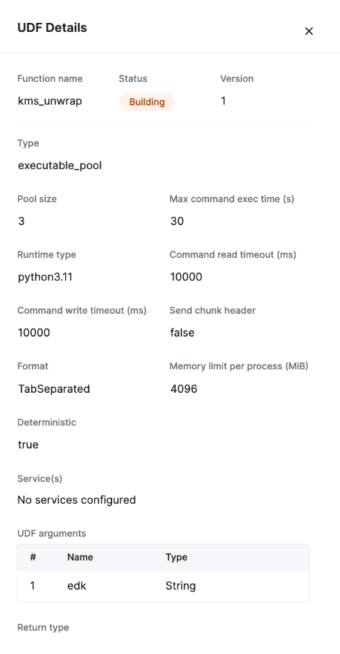

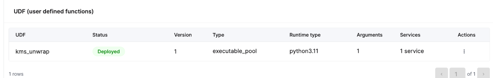

```
$ clickhouse client … -q "SELECT name, origin FROM system.functions WHERE name = 'kms_unwrap'"
kms_unwrap	ExecutableUserDefined
```

### 5. ClickPipe: Postgres CDC (11:10:32 → 11:14:52, 248 s)

`clickpipe-create.sh` (`POST …/clickpipes`, type `aurorapostgres`, publication `clickpipes`, `syncIntervalSeconds` 10, `pullBatchSize` 100000, `public.users` → `raw.users`).

```
11:10:45 Provisioning … 11:14:11 Provisioning
11:14:31 Snapshot
11:14:52 Running
create -> Running: 248 s
```

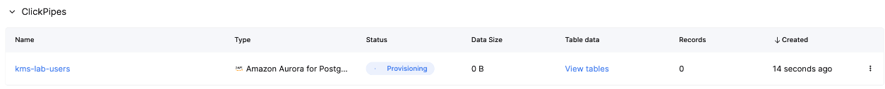

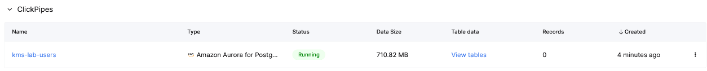

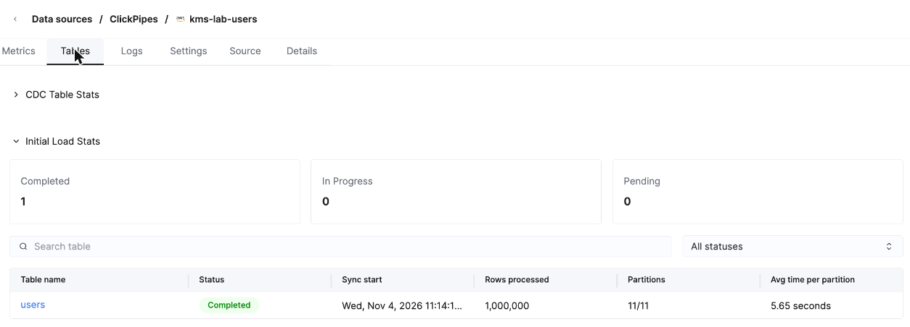

### 6. Decrypting views and backfill

```
$ clickhouse client … --queries-file sql/30-mvs.sql                 # users_a_mv (UDF), users_b_mv (dictionary)
$ clickhouse client … --time --queries-file sql/31-backfill.sql     # A: 13.059 s
$ clickhouse client … --time --queries-file sql/32-backfill-b.sql   # B: 10.575 s
users_a	1000000	1000000	1000000	1000000      # rows, props_ok, email_ok, phone_ok
users_b	1000000	1000000	1000000	1000000
```

The same check in the SQL console, and what the two tables hold:

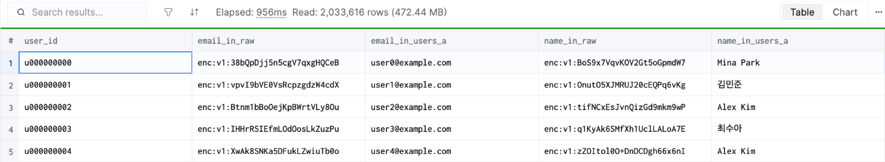

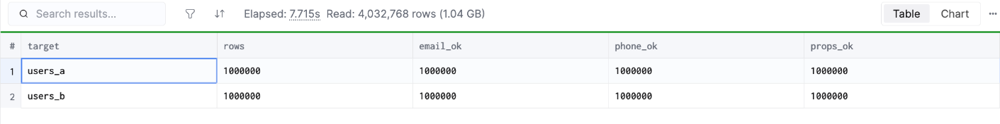

### 7. CDC: updates with rotated keys, deletes, one key per row (11:20:27)

`cdc-changes.sh` committed 10,000 updates (8 new data keys), 1,000 deletes and 10,000 new users with a data key each. Row counts every 10 s:

```
11:20:28 raw/a/b: 1000000 1000000 1000000
11:20:38 raw/a/b: 1010000 1000000 1009000     # raw and B within 11 s
…
11:24:47 raw/a/b: 1010000 1009000 1009000     # A after 4 min 20 s
query_views_log: users_a_mv 240,305 ms · users_b_mv 464 ms (21,000 rows each)
```

While A waited on 10,000 KMS calls, the batch stayed at `Pushing` with 0 rows pushed, and A lagged behind raw and B:

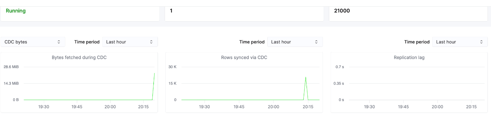

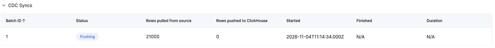

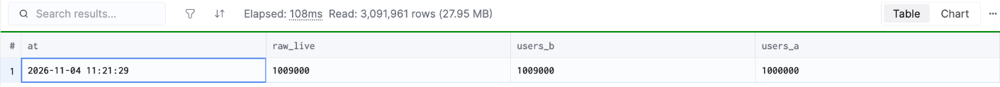

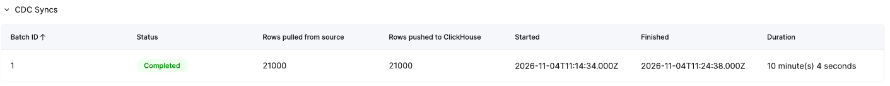

```
$ clickhouse client … --param_t=users_a --queries-file sql/42-verify-final.sql
users_a	1009000	1009000	0	0	1009000      # expected_live, rows, unexpected, deleted_still_visible, all_fields_ok
users_b	1009000	1009000	0	0	1009000
```

KMS `Decrypt` calls by the UDF role, from CloudTrail (`out/cloudtrail.txt`):

```
11:15 16 · 11:20 857 · 11:21 2,515 · 11:22 2,483 · 11:23 2,552 · 11:24 1,601     # the 10,000 per-row keys
11:39 2 · 11:40 918 · 11:41 1,558                                                # after the recovery, query-time decryption with a cold cache
total 12,502, no errors
```

### 8. Who can reach a key

A user `analyst` with `GRANT SELECT ON app.users_a` only (`out/exposure.txt`, key masked here):

```
1 SELECT count() FROM app.users_a            → 1009000
2 SELECT count() FROM raw.users              → Code: 497 Not enough privileges
3 SELECT kms_unwrap('<edk of tenant t000>')  → a9fa9557…(masked)…93e7fa6c      # the plaintext data key
4 SELECT count() FROM keys.plain_keys        → Code: 497 Not enough privileges
5 SELECT dictGet('keys.plain_key_dict', …)   → Code: 497 Not enough privileges
```

Two control queries with a real key, one inside `decrypt()`, one inside `unhex()`, and how `system.query_log` stored them (the console query replaces any 64-hex string with a placeholder):

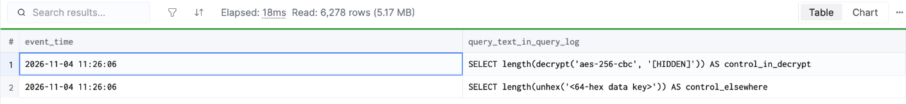

### 9. Broken UDF credentials (11:27 → 11:39)

Version 2 of the UDF carried invalid credentials (build 113 s, attach 113 s, `SYSTEM RELOAD FUNCTION`). Then 100 users with a new key (11:31:54) and one update of a known user (11:32:34):

```
raw.users (new users, non-FINAL): 200    users_b: 200    users_a: 0    probe update in raw and users_b: yes, in users_a: no
query_log: exception_code 754 from the ClickPipes user at 11:32:04 and 11:33:04
```

The pipe stayed `Running`, but both new batches stayed at `Pushing` with 0 pushed; ClickPipes kept retrying, so raw and B received the rows (twice, merged by `FINAL`) and A received nothing. Compared with the first run, the later update did reach raw and B this time — the retried batch picked it up — but no batch completed until the UDF worked again.

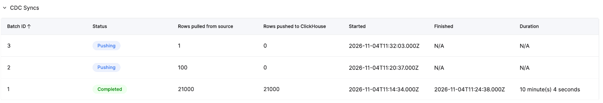

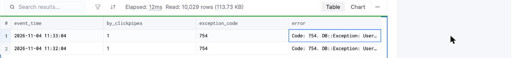

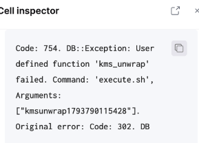

Recovery: `udf-deploy.sh` published version 3 with fresh credentials (177 s to deployed and reloaded); A had the 100 users and the update 265 s after the start (11:39:09). Replication lag climbed while the batches were stuck:

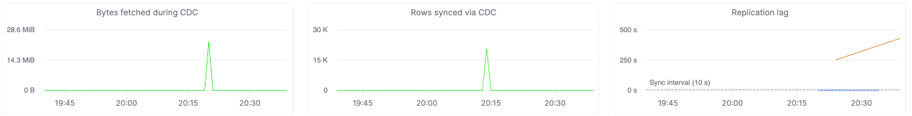

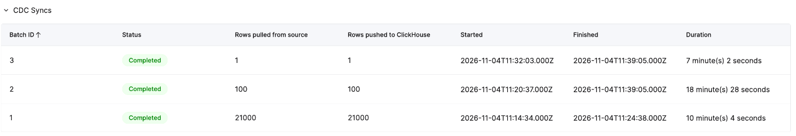

### 10. End state and query-time decryption

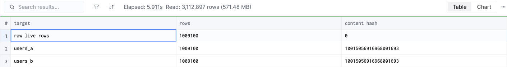

```
search (41,911 matches)            stored plaintext   decrypt at query time
run 1                              0.175 s            61.572 s   (cold key cache, 10,000 per-row keys)
run 2                              0.168 s             1.619 s
run 3                              0.160 s             1.534 s
```

### 11. Teardown

`destroy.sh` deleted the ClickPipe, detached and deleted the UDF, dropped the lab databases and the `analyst` user, and ran `terraform destroy`; the test service was stopped and deleted with the Cloud API; the KMS key went to `PendingDeletion` (7 days).

## 한국어

이 실습을 처음부터 끝까지 두 번째로 돌린 기록입니다. 단계마다 실행한 명령, 출력, 그리고 화면이 있는 단계는 ClickHouse Cloud 콘솔 캡처를 붙였습니다. [README](README.md)의 수치는 같은 날 첫 실행에서 나왔고, 이번 실행은 과정을 남기려고 같은 순서로 다시 돌렸습니다. 시각은 UTC입니다. 비밀번호·호스트·키·계정 ID는 가리거나 잘라냈고, 데이터는 합성입니다.

환경: AWS `ap-northeast-2`, Aurora PostgreSQL 16.13 `db.t4g.medium`, 새 ClickHouse Cloud 서비스(replica 1개, 8 GiB, ClickHouse 26.6.1.2455), Terraform 1.16.4 · `hashicorp/aws` 5.100.0, `create_udf_user = false`(계정 SCP가 `iam:CreateUser`를 막음). AWS 콘솔에는 로그인하지 않아서 AWS 쪽 상태는 CLI 출력으로 남겼습니다.

### 1. AWS: Terraform (10:58:17 → 11:05:33)

`terraform apply`가 리소스 17개를 만들었고, Aurora writer에 5분 58초가 걸렸습니다. 만든 뒤 상태(`out/aws-state.txt`, 가림 처리)는 영어 1절과 같습니다. Aurora 16.13 available, 스토리지 암호화 켜짐, `rds.logical_replication = 1`, KMS 고객 관리 대칭 키, UDF 역할은 실습 키에 대한 `kms:Decrypt`만 허용, 5432 포트는 ClickPipes 서울 IP 6개와 운영자 /32만 엽니다.

### 2. 데이터: 유저 1,000,000명, 데이터 키 8개

생성에 49.8초(`GenerateDataKey` 8번), Aurora `COPY`에 36초가 걸렸습니다. 812 MB, 서로 다른 `edk` 8개입니다.

### 3. ClickHouse Cloud 테스트 서비스

Cloud API로 만들었습니다(replica 1개, 8 GiB, IP 허용 목록은 운영자 /32). SQL 함수, 결과 테이블, 경로 B용 평문 키, 정답 데이터는 `clickhouse client`로 넣었습니다.


### 4. UDF `kms_unwrap` (11:01:48 → 11:10:04)

`udf-deploy.sh`가 zip을 만들고(`main.py` + 역할의 1시간 STS 자격 증명을 담은 `config.json`, 2,593바이트) 업로드 URL로 올린 뒤, UDF를 만들고 서비스에 붙입니다. 첫 UDF를 붙이면 서비스가 순차 재시작합니다.


### 5. ClickPipe: Postgres CDC (11:10:32 → 11:14:52, 248초)

`Provisioning` 약 3분 40초 → `Snapshot` → `Running`. 초기 적재는 1,000,000행, 파티션 11개, 파티션당 평균 5.65초였습니다.


### 6. 복호화 뷰와 채우기

뷰 둘을 만들고 이미 들어온 100만 행을 채웠습니다. A(UDF + KMS)는 13.059초, B(딕셔너리)는 10.575초였고, 둘 다 1,000,000행 모두 정답과 같았습니다.


### 7. CDC: 키를 바꾼 갱신, 삭제, 행마다 키 (11:20:27)

갱신 10,000건(새 데이터 키 8개), 삭제 1,000건, 키가 하나씩인 새 유저 10,000명을 커밋했습니다. raw와 B는 11초 안에 반영됐고, A는 4분 20초 뒤에 따라잡았습니다. 뷰 시간은 A 240,305 ms, B 464 ms입니다. A가 KMS 호출 1만 번을 기다리는 동안 배치는 `Pushing`에 0행 그대로였습니다.


CDC 뒤 A·B 모두 1,009,000 / 1,009,000이 정답이었고, 삭제된 행은 보이지 않았습니다. CloudTrail에서 본 UDF 역할의 KMS `Decrypt` 호출은 모두 12,502번이었고 오류는 없었습니다. 그중 약 1만 번이 행마다 키, 약 2,500번이 복구 뒤 캐시가 빈 상태의 쿼리 시점 복호화입니다.

### 8. 누가 키에 닿을 수 있나

`app.users_a`에 `SELECT`만 받은 `analyst`로 확인했습니다. 원본 테이블, 키 테이블, 딕셔너리는 모두 `Code: 497`로 거부됐습니다. 그런데 `kms_unwrap('<edk>')`는 평문 데이터 키를 돌려줬습니다(여기서는 가림 처리).

진짜 키로 대조 쿼리를 두 개 돌리고 `system.query_log`에 남은 모습을 콘솔에서 봤습니다. 콘솔 쿼리가 64자리 16진수를 자리표시로 바꿨습니다.


### 9. UDF 자격 증명이 깨졌을 때 (11:27 → 11:39)

잘못된 자격 증명으로 UDF 2버전을 만들어 붙였습니다(빌드 113초, 붙이기 113초, `SYSTEM RELOAD FUNCTION`). 그다음 새 키 유저 100명(11:31:54)과 기존 유저 갱신 1건(11:32:34)을 넣었습니다.

- 파이프 상태는 `Running`이었지만, 새 배치 둘이 `Pushing`에 0행 반영으로 멈췄습니다.
- ClickPipes가 계속 다시 시도해서 raw와 B에는 행이 들어갔습니다(두 번씩 들어갔고 `FINAL`이 하나로 합침). A에는 아무것도 들어가지 않았습니다.
- 첫 실행과 달리 이번에는 나중의 갱신도 raw와 B에 들어갔습니다. 다시 시도한 배치가 그 갱신까지 함께 가져갔기 때문입니다. 그래도 UDF가 다시 동작할 때까지 완료된 배치는 하나도 없었습니다.


복구는 새 자격 증명으로 3버전을 배포하는 것이었고, 배포와 reload까지 177초가 걸렸습니다. A에는 시작 265초 뒤(11:39:09) 유저 100명과 갱신이 들어왔습니다. 멈춘 동안 복제 지연은 계속 올라갔습니다.


### 10. 최종 상태와 쿼리 시점 복호화


41,911건이 일치하는 검색에서 저장된 평문은 0.16~0.18초, 쿼리 시점 복호화는 첫 실행 61.6초(키 캐시가 비고 행마다 키 1만 개), 이후 1.5~1.6초였습니다.

### 11. 정리

`destroy.sh`로 ClickPipe, UDF, 실습 데이터베이스, `analyst` 사용자를 지우고 `terraform destroy`를 실행했습니다. 테스트 서비스는 Cloud API로 멈춘 뒤 지웠고, KMS 키는 `PendingDeletion`(7일)입니다.
